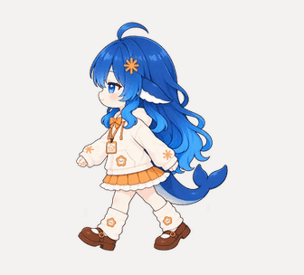
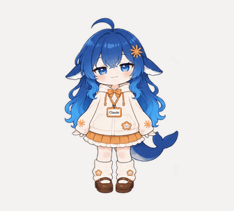
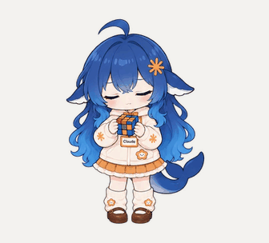

# dsh-pet-claude

穿着 Claude 工牌的蓝发大肥鱼，站在桌边陪你，或者托着腮看看你。

基于 [PC2005-cloud/dsh-pet](https://github.com/PC2005-cloud/dsh-pet) 独立维护，包含我们制作的两种形态、119 段透明动画和 16 条日常动作链。

**[下载 Windows 解压即用版](https://github.com/123pc/dsh-pet-claude/releases/download/claude-v0.7.1/claude-dafeiyu-windows-x64.zip)** · [全部下载](https://github.com/123pc/dsh-pet-claude/releases) · [安装说明](docs/INSTALL.md)

## 站起来，活动一下

|             自然走路             |            挥手打招呼            |             专心玩魔方             |
| :------------------------------: | :------------------------------: | :--------------------------------: |
|  |  |  |

走路时会真的在屏幕上移动。点一点有回应，拖一拖换位置，右键可以换装、点播动作。

## 趴着陪你，也有自己的小动作

|               摇摇尾巴                |              随手拨拨头发               |           摇头哼歌（无声）           |
| :-----------------------------------: | :-------------------------------------: | :----------------------------------: |
|  |  |  |

## 你忙的时候，它也拿出电脑

拿出并打开电脑 → 敲键盘 → 揉眼伸肩 → 合上收起，再回来陪你。

平时大部分时间安静待机，偶尔在随机时刻做一段连贯的小活动；困了就打哈欠、眯一会儿、再伸个懒腰。[看看全部日常动作链 →](community-pets/claude-dafeiyu/ACTIVITY-CHAINS.md)

## 开始陪伴

**Windows x64：** 下载上面的 ZIP，解压到可写文件夹，双击 **`启动桌宠.cmd`**。无需安装 Node.js 或 DSH。右键桌宠 → **换装**，选择「Claude-大肥鱼-站立」或「Claude-大肥鱼-托腮」；退出使用托盘菜单。

已使用 DSH 的用户，可安装发布页的插件包与角色包。[插件安装与源码构建 →](docs/INSTALL.md)

解压版的设置保存在它自己的 `data/`，与已有 DSH 配置分开。DSH 任务状态联动需要插件模式；解压版仍会自行播放日常活动。当前发行包在 Windows 验证，macOS / Linux 可从源码构建，尚未完成对应实机验收。

## 来源与致谢

引擎与原版大肥鱼来自 [PC2005-cloud/dsh-pet](https://github.com/PC2005-cloud/dsh-pet)，保留原作者版权与 [MIT 许可证](LICENSE)。本分支制作了 Claude 打扮的站立、托腮形态及动作素材，并加入换装、随机日常与办公衔接。

[上游使用文档](UPSTREAM-README.md) · [配置说明](CONFIG.md) · [第三方组件许可](THIRD-PARTY.md) · [反馈问题](https://github.com/123pc/dsh-pet-claude/issues)
