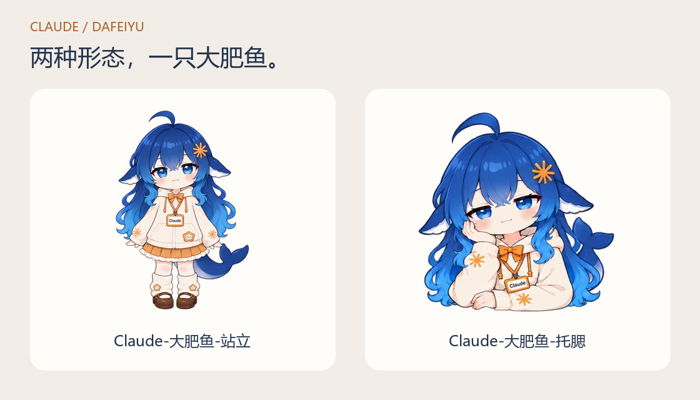

# dsh-pet-claude

穿着 Claude 工牌的蓝发大肥鱼，站在桌边陪你，或者托着腮看看你。

基于 [PC2005-cloud/dsh-pet](https://github.com/PC2005-cloud/dsh-pet) 独立维护，包含我们制作的两种形态、119 段透明动画和 16 条日常动作链。

**[下载 Windows 解压即用版](https://github.com/123pc/dsh-pet-claude/releases/download/claude-v0.7.2/claude-dafeiyu-windows-x64.zip)** · [全部下载](https://github.com/123pc/dsh-pet-claude/releases) · [安装说明](docs/INSTALL.md)

## 动作一览

**41 段单动作预览 + 完整办公过程 + 3 组动作链。** 想看更多，可以打开[全部 119 段动作图鉴](docs/ACTIONS.md)。

走路会带着桌宠在屏幕上移动；点一点有回应，拖一拖换位置，右键可以换装、点播动作。

### 站起来，活动一下

|                              自然走路                              |                              点击回应-元气挥手                              |                              超大伸懒腰                              |
| :----------------------------------------------------------------: | :-------------------------------------------------------------------------: | :------------------------------------------------------------------: |
|  |  |  |

|                              哈欠连天                              |                              原地小憩沉眠                              |                              用鲸鱼尾巴拍打地面                              |
| :----------------------------------------------------------------: | :--------------------------------------------------------------------: | :--------------------------------------------------------------------------: |
|  |  |  |

### 玩耍、音乐与一点小魔术

|                              原地专心玩魔方                              |                              撸猫                              |                              放风筝                              |
| :----------------------------------------------------------------------: | :------------------------------------------------------------: | :--------------------------------------------------------------: |
|  |  |  |

|                              荡秋千                              |                              小提琴演奏                              |                              变鸽子                              |
| :--------------------------------------------------------------: | :------------------------------------------------------------------: | :--------------------------------------------------------------: |
|  |  |  |

### 开饭了，今天吃点什么

|                              吃白饭                              |                              大口吃零食                              |                              吃冰淇淋融化                              |
| :--------------------------------------------------------------: | :------------------------------------------------------------------: | :--------------------------------------------------------------------: |
|  |  |  |

|                              吃西瓜                              |                              涮火锅                              |                              吃大闸蟹                              |
| :--------------------------------------------------------------: | :--------------------------------------------------------------: | :----------------------------------------------------------------: |
|  |  |  |

### 小表情，也会回应你

|                              点击回应-开心跃动                              |                              点击回应-害羞惊讶                              |                              点击回应-傲娇生气                              |
| :-------------------------------------------------------------------------: | :-------------------------------------------------------------------------: | :-------------------------------------------------------------------------: |
|  |  |  |

|                              点击回应-挠痒咯咯笑                              |                              被吓一跳                              |                              女仆屈膝礼仪                              |
| :---------------------------------------------------------------------------: | :----------------------------------------------------------------: | :--------------------------------------------------------------------: |
|  |  |  |

### 一年四季，都有一点仪式感

|                              中秋赏月吃月饼                              |                              堆雪人                              |                              讨糖南瓜灯                              |
| :----------------------------------------------------------------------: | :--------------------------------------------------------------: | :------------------------------------------------------------------: |
|  |  |  |

|                              装点圣诞树                              |                              放烟花                              |                              收红包                              |
| :------------------------------------------------------------------: | :--------------------------------------------------------------: | :--------------------------------------------------------------: |
|  |  |  |

### 趴着陪你，也有自己的小动作

|                              托腮·安静陪伴                              |                              托腮·轻摇鲸尾                              |                              托腮·指尖拨头发                              |
| :---------------------------------------------------------------------: | :---------------------------------------------------------------------: | :-----------------------------------------------------------------------: |
|  |  |  |

|                              托腮·摇头哼歌                              |                              托腮·眯眼小憩                              |                              托腮·轻声回应                              |
| :---------------------------------------------------------------------: | :---------------------------------------------------------------------: | :---------------------------------------------------------------------: |
|  |  |  |

### 你忙的时候，它也拿出电脑

拿出并打开电脑 → 敲键盘或停笔思考 → 揉眼伸肩 → 合上收起，再回来陪你。

|                              托腮办公·拿出并打开电脑                              |                              托腮办公·轻敲键盘                              |                              托腮办公·停笔想一想                              |
| :-------------------------------------------------------------------------------: | :-------------------------------------------------------------------------: | :---------------------------------------------------------------------------: |
|  |  |  |

|                              托腮办公·揉眼伸肩                              |                              托腮办公·收起电脑                              |
| :-------------------------------------------------------------------------: | :-------------------------------------------------------------------------: |
|  |  |

## 动作连起来，就有了自己的小日常

平时安静陪伴，偶尔在随机时刻开始一段连贯的小活动，结束后再回到待机。下面按真实动作顺序和循环次数播放。

### 困了，眯一会儿

哈欠连天 → 原地小憩沉眠 → 超大伸懒腰

### 吃饱散散步

吃白饭 → 自然走路 → 东张西望

### 给你变个小魔术

扑克魔术 → 变鸽子 → 凭空生花 → 点击回应-元气挥手

[全部 16 条日常动作链 →](community-pets/claude-dafeiyu/ACTIVITY-CHAINS.md) · [全部 119 段动作图鉴 →](docs/ACTIONS.md)

## 开始陪伴

**Windows x64：** 下载上面的 ZIP，解压到可写文件夹，双击 **`启动桌宠.cmd`**。无需安装 Node.js 或 DSH。右键桌宠 → **换装**，选择「Claude-大肥鱼-站立」或「Claude-大肥鱼-托腮」；退出使用托盘菜单。

已使用 DSH 的用户，安装发布页的 dsh-pet-claude.tgz 后即可自动准备角色。[插件安装与源码构建 →](docs/INSTALL.md)

解压版的设置保存在它自己的 `data/`，与已有 DSH 配置分开。DSH 任务状态联动需要插件模式；解压版仍会自行播放日常活动。当前发行包在 Windows 验证，macOS / Linux 可从源码构建，尚未完成对应实机验收。

## 来源与致谢

引擎与原版大肥鱼来自 [PC2005-cloud/dsh-pet](https://github.com/PC2005-cloud/dsh-pet)，保留原作者版权与 [MIT 许可证](LICENSE)。本分支制作了 Claude 打扮的站立、托腮形态及动作素材，并加入换装、随机日常与办公衔接。

[上游使用文档](UPSTREAM-README.md) · [配置说明](CONFIG.md) · [第三方组件许可](THIRD-PARTY.md) · [反馈问题](https://github.com/123pc/dsh-pet-claude/issues)
