# 全部动作图鉴

**119 段动画：站立 108 段，托腮 11 段。** 以下每一格都是对应的实际动作片段，点击动图可以放大。

[返回项目首页](../README.md) · [随机日常与动作链](../community-pets/claude-dafeiyu/ACTIVITY-CHAINS.md)

动图较多，可展开自己感兴趣的分类查看。

<strong>走动与互动 · 12 段</strong>

|                           安静站立·眨眼呼吸                            |                           东张西望                            |                           被鼠标拖拽悬空反馈                            |
| :--------------------------------------------------------------------: | :-----------------------------------------------------------: | :---------------------------------------------------------------------: |
|  | 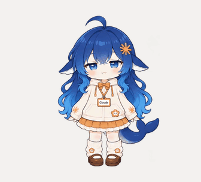 |  |

|                           自然走路                            |                           螃蟹走路                            |                           原地漂浮踏步                            |
| :-----------------------------------------------------------: | :-----------------------------------------------------------: | :---------------------------------------------------------------: |
|  |  |  |

|                           原地左转奔跑                            |                           点击回应-开心跃动                            |                           点击回应-害羞惊讶                            |
| :---------------------------------------------------------------: | :--------------------------------------------------------------------: | :--------------------------------------------------------------------: |
| 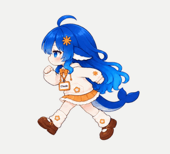 |  |  |

|                           点击回应-傲娇生气                            |                           点击回应-挠痒咯咯笑                            |                           点击回应-元气挥手                            |
| :--------------------------------------------------------------------: | :----------------------------------------------------------------------: | :--------------------------------------------------------------------: |
|  |  |  |

<strong>日常与休息 · 19 段</strong>

|                           悠闲哼歌                            |                           超大伸懒腰                            |                           原地敲击桌面互动                            |
| :-----------------------------------------------------------: | :-------------------------------------------------------------: | :-------------------------------------------------------------------: |
|  |  |  |

|                           原地重力下蹲压缩                            |                           哈欠连天                            |                           原地小憩沉眠                            |
| :-------------------------------------------------------------------: | :-----------------------------------------------------------: | :---------------------------------------------------------------: |
|  |  |  |

|                           女仆屈膝礼仪                            |                           被吓一跳                            |                           小幅度原地360度旋转展示                            |
| :---------------------------------------------------------------: | :-----------------------------------------------------------: | :--------------------------------------------------------------------------: |
|  |  |  |

|                           偷吃零食被抓住                            |                           用鲸鱼尾巴拍打地面                            |                           打瞌睡被惊醒                            |
| :-----------------------------------------------------------------: | :---------------------------------------------------------------------: | :---------------------------------------------------------------: |
|  |  |  |

|                           照镜子                            |                           整体换装试色                            |                           轻快记录                            |
| :---------------------------------------------------------: | :---------------------------------------------------------------: | :-----------------------------------------------------------: |
|  |  |  |

|                           写代码                            |                           摇扇纳凉                            |                           晨间刷牙                            |
| :---------------------------------------------------------: | :-----------------------------------------------------------: | :-----------------------------------------------------------: |
|  |  |  |

|                           待机呼吸休闲                            |
| :---------------------------------------------------------------: |
|  |

<strong>玩耍与音乐 · 27 段</strong>

|                           原地专心玩魔方                            |                           原地蹲下玩玩具汽车                            |                           鲸鱼吐泡泡特效                            |
| :-----------------------------------------------------------------: | :---------------------------------------------------------------------: | :-----------------------------------------------------------------: |
|  |  |  |

|                           原地跳跃抓碎头顶物品                            |                           玩游戏气急败坏                            |                           玩水枪                            |
| :-----------------------------------------------------------------------: | :-----------------------------------------------------------------: | :---------------------------------------------------------: |
|  | 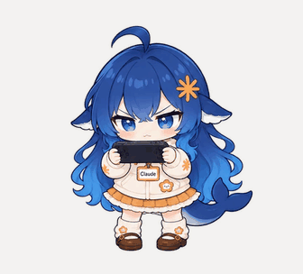 | 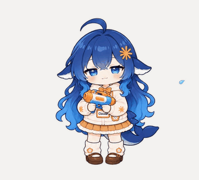 |

|                           小提琴演奏                            |                           蓝鲸现世                            |                           优雅女仆舞                            |
| :-------------------------------------------------------------: | :-----------------------------------------------------------: | :-------------------------------------------------------------: |
|  |  |  |

|                           轻快摇摆舞                            |                           可爱宅舞                            |                           吹气球                            |
| :-------------------------------------------------------------: | :-----------------------------------------------------------: | :---------------------------------------------------------: |
|  |  |  |

|                           动物环绕                            |                           放风筝                            |                           拆礼物                            |
| :-----------------------------------------------------------: | :---------------------------------------------------------: | :---------------------------------------------------------: |
|  |  |  |

|                           变鸽子                            |                           扑克魔术                            |                           抽陀螺                            |
| :---------------------------------------------------------: | :-----------------------------------------------------------: | :---------------------------------------------------------: |
|  | 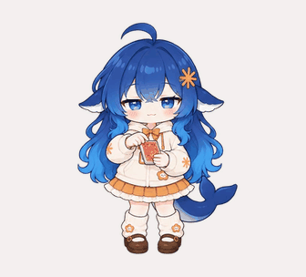 |  |

|                           吹笛子                            |                           蝴蝶蜜蜂环绕头顶开花                            |                           撸猫                            |
| :---------------------------------------------------------: | :-----------------------------------------------------------------------: | :-------------------------------------------------------: |
|  |  |  |

|                           凭空生花                            |                           骑木马                            |                           三球抛接                            |
| :-----------------------------------------------------------: | :---------------------------------------------------------: | :-----------------------------------------------------------: |
|  | 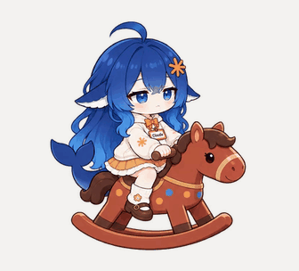 |  |

|                           踢毽子                            |                           下五子棋                            |                           荡秋千                            |
| :---------------------------------------------------------: | :-----------------------------------------------------------: | :---------------------------------------------------------: |
|  |  |  |

<strong>开饭与零食 · 12 段</strong>

|                           吃白饭                            |                           大口吃零食                            |                           吃Token                            |
| :---------------------------------------------------------: | :-------------------------------------------------------------: | :----------------------------------------------------------: |
|  |  |  |

|                           吃早餐                            |                           吃午餐                            |                           吃晚餐                            |
| :---------------------------------------------------------: | :---------------------------------------------------------: | :---------------------------------------------------------: |
|  |  |  |

|                           吃冰淇淋融化                            |                           吃大闸蟹                            |                           吃糖葫芦                            |
| :---------------------------------------------------------------: | :-----------------------------------------------------------: | :-----------------------------------------------------------: |
|  |  | 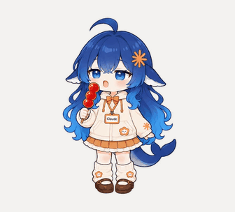 |

|                           吃长寿面                            |                           吃西瓜                            |                           涮火锅                            |
| :-----------------------------------------------------------: | :---------------------------------------------------------: | :---------------------------------------------------------: |
|  |  |  |

<strong>时节与节日 · 21 段</strong>

|                           被落叶淹没                            |                           中秋赏月吃月饼                            |                           堆雪人                            |
| :-------------------------------------------------------------: | :-----------------------------------------------------------------: | :---------------------------------------------------------: |
|  |  |  |

|                           放烟花                            |                           吃粽子                            |                           吃年糕                            |
| :---------------------------------------------------------: | :---------------------------------------------------------: | :---------------------------------------------------------: |
|  |  |  |

|                           吃青团                            |                           吃腊八粥                            |                           吃重阳糕                            |
| :---------------------------------------------------------: | :-----------------------------------------------------------: | :-----------------------------------------------------------: |
|  |  |  |

|                           收红包                            |                           写福字                            |                           穿针乞巧                            |
| :---------------------------------------------------------: | :---------------------------------------------------------: | :-----------------------------------------------------------: |
|  |  |  |

|                           舞狮头                            |                           讨糖南瓜灯                            |                           插茱萸赏菊                            |
| :---------------------------------------------------------: | :-------------------------------------------------------------: | :-------------------------------------------------------------: |
|  |  | 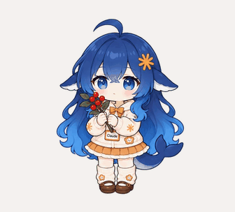 |

|                           放河灯                            |                           萌化小幽灵                            |                           装点圣诞树                            |
| :---------------------------------------------------------: | :-------------------------------------------------------------: | :-------------------------------------------------------------: |
|  |  |  |

|                           放孔明灯                            |                           吃汤圆                            |                           吃饺子                            |
| :-----------------------------------------------------------: | :---------------------------------------------------------: | :---------------------------------------------------------: |
|  | 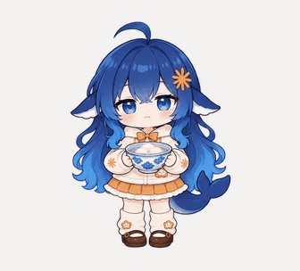 |  |

<strong>思考与碎碎念 · 5 段</strong>

|                           是啊，吃什么                            |                           深度思考碎碎念                            |                           碎碎念-擦桌碎碎念                            |
| :---------------------------------------------------------------: | :-----------------------------------------------------------------: | :--------------------------------------------------------------------: |
| 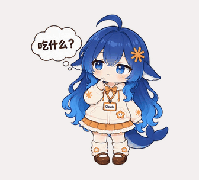 |  |  |

|                           碎碎念-发呆碎碎念                            |                           碎碎念-对屏碎碎念                            |
| :--------------------------------------------------------------------: | :--------------------------------------------------------------------: |
|  |  |

<strong>工作状态 · 6 段</strong>

|                           工作状态-思考冒泡                            |                           工作状态-忙碌点按                            |                           工作状态-清点归档                            |
| :--------------------------------------------------------------------: | :--------------------------------------------------------------------: | :--------------------------------------------------------------------: |
|  |  |  |

|                           工作状态-原地踱步张望                            |                           工作状态-雀跃庆祝                            |                           工作状态-垂头叹气冒汗                            |
| :------------------------------------------------------------------------: | :--------------------------------------------------------------------: | :------------------------------------------------------------------------: |
|  |  |  |

<strong>余额表情 · 6 段</strong>

|                           余额-钱袋满溢                            |                           余额-金袋叮当                            |                           余额-钱袋如常                            |
| :----------------------------------------------------------------: | :----------------------------------------------------------------: | :----------------------------------------------------------------: |
|  |  |  |

|                           余额-数金皱眉                            |                           余额-袋空如洗                            |                           余额-分文不剩                            |
| :----------------------------------------------------------------: | :----------------------------------------------------------------: | :----------------------------------------------------------------: |
|  | 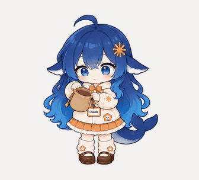 | 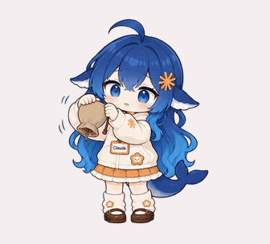 |

<strong>托腮与办公 · 11 段</strong>

|                           托腮·安静陪伴                            |                           托腮·指尖拨头发                            |                           托腮·摇头哼歌                            |
| :----------------------------------------------------------------: | :------------------------------------------------------------------: | :----------------------------------------------------------------: |
|  |  |  |

|                           托腮·眯眼小憩                            |                           托腮·轻声回应                            |                           托腮·轻摇鲸尾                            |
| :----------------------------------------------------------------: | :----------------------------------------------------------------: | :----------------------------------------------------------------: |
|  |  |  |

|                           托腮办公·停笔想一想                            |                           托腮办公·拿出并打开电脑                            |                           托腮办公·揉眼伸肩                            |
| :----------------------------------------------------------------------: | :--------------------------------------------------------------------------: | :--------------------------------------------------------------------: |
|  |  |  |

|                           托腮办公·收起电脑                            |                           托腮办公·轻敲键盘                            |
| :--------------------------------------------------------------------: | :--------------------------------------------------------------------: |
|  |  |

